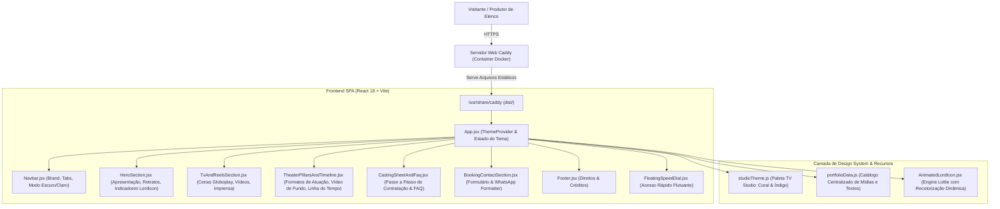

# 🏛️ Documento de Arquitetura de Software (ARCHITECTURE.md)
> **Projeto:** Portal Artístico & Portfólio Oficial de Valesca Almeida (Vavá)  
> **Domínio de Produção:** [https://valescaalmeida.com](https://valescaalmeida.com)  
> **Versão:** 2.0.0  
> **Padrão Arquitetural:** Component-Based Single Page Application (SPA) + Containerized Reverse Proxy

---

## 1. Visão Geral e Propósito do Sistema

O portal foi concebido para atender a dois públicos-alvo estratégicos:
1. **Produtores e Diretores de Elenco (TV, Cinema e Streaming):** Acesso rápido a self-tapes, cenas de teledramaturgia no Globoplay (personagem *Olga* na novela *Coração Acelerado* da TV Globo), ensaio fotográfico em alta resolução e ficha de contato direto para testes.
2. **Contratantes de Eventos e Publicidade:** Informações sobre shows de Stand-Up Comedy, atuação como Mestre de Cerimônias (MC), campanhas publicitárias e disponibilidade na ponte aérea Goiânia (GYN) ⇄ Rio de Janeiro (RJ).

---

## 2. Diagrama de Arquitetura da Solução



---

## 3. Estrutura de Diretórios e Responsabilidades

```
vava/
├── .github/
│   └── workflows/
│       └── deploy.yml          # Pipeline CI/CD GitHub Actions para GitHub Pages
├── .specify/                   # Esteira SDD (Spec-Kit)
│   ├── memory/                 # Constituição e Glossário do Projeto
│   ├── specs/                  # Especificações de Features ativas e históricas
│   └── templates/              # Modelos padronizados de Spec, Plano e Tarefas
├── public/
│   └── assets/
│       ├── ensaio/             # 24 fotos em alta definição do ensaio fotográfico
│       ├── icons/              # 9 arquivos JSON Lottie para ícones animados Lordicon
│       ├── profile/            # Fotos de perfil oficiais e thumbnails
│       ├── theater/            # Vídeo autêntico de stand-up (stage-bg.mp4) e poster
│       └── catalog.json        # Manifesto estruturado de dados
├── src/
│   ├── components/             # Componentes React modulares e desacoplados
│   │   ├── AnimatedLordIcon.jsx        # Componente que recolore JSON Lottie em tempo real
│   │   ├── BookingContactSection.jsx   # Formulário interativo com disparo para WhatsApp
│   │   ├── CastingSheetAndFaq.jsx      # Fluxo de contratação e sanfona de dúvidas
│   │   ├── FloatingSpeedDial.jsx       # Botão flutuante de contatos rápidos
│   │   ├── Footer.jsx                  # Rodapé institucional
│   │   ├── HeroSection.jsx             # Seção de abertura com carrossel de retratos
│   │   ├── Navbar.jsx                  # Barra de navegação com alternância de tema
│   │   ├── TheaterPillarsAndTimeline.jsx # Pilares de atuação e vídeo de palco em loop
│   │   └── TvAndReelsSection.jsx       # Exibição de cenas de TV, stand-up e clipping
│   ├── data/
│   │   └── portfolioData.js    # Fonte única da verdade (Single Source of Truth) para dados
│   ├── theme/
│   │   └── studioTheme.js      # Definição dos tokens do Material UI v6 e modo escuro/claro
│   ├── utils/
│   │   └── assetUrl.js         # Utilitário que resolve caminhos de assets em subcaminhos ou raiz
│   ├── App.jsx                 # Componente raiz da aplicação
│   └── main.jsx                # Ponto de entrada do React DOM
├── Caddyfile                   # Configuração de produção do servidor Caddy (SSL, Cache, SPA)
├── Dockerfile                  # Build multi-stage (Node.js 20 Builder -> Caddy Alpine Runtime)
├── docker-compose.yml          # Definição do container e volumes persistentes de SSL
├── deploy.sh                   # Script de atualização automática na VPS com 1 comando
├── package.json                # Dependências e scripts de build
└── vite.config.js              # Configuração do Vite com suporte dinâmico a base URL
```

---

## 4. Decisões Arquiteturais Chave (ADRs)

### ADR 01: Servidor Web Caddy com SSL Automático
* **Contexto:** Na VPS da Hostinger, o site precisava de certificados HTTPS válidos, renovação automática, redirecionamento HTTP->HTTPS e suporte a SPA sem exigir instalação de servidores pesados no host.
* **Decisão:** Utilizar a imagem oficial `caddy:alpine` dentro do Docker Compose com volume persistente para os certificados (`vava_caddy_data`).
* **Consequência:** Zero manutenção de certificados e suporte nativo a HTTP/2 e HTTP/3 com compressão Zstandard.

### ADR 02: Single Source of Truth para Conteúdo (`portfolioData.js`)
* **Contexto:** Manter textos, fotos, vídeos e links de contato espalhados pelo JSX dificulta a manutenção e atualizações da artista.
* **Decisão:** Centralizar todos os dados em [`src/data/portfolioData.js`](file:///c:/Users/Douglas/Documents/vava/src/data/portfolioData.js) com resolução dinâmica de URLs via `assetUrl()`.
* **Consequência:** Qualquer nova foto, cena ou telefone pode ser alterado em um único lugar sem risco de quebrar o layout.

### ADR 03: Ícones Animados Lordicon com Recolorização Dinâmica em SVG/Blob
* **Contexto:** Ícones estáticos perdem expressividade artística, mas animações Lottie pré-renderizadas possuem cores fixas que não combinavam com a alternância de cores do tema.
* **Decisão:** O componente [`AnimatedLordIcon.jsx`](file:///c:/Users/Douglas/Documents/vava/src/components/AnimatedLordIcon.jsx) intercepta o JSON vetorial do Lottie, substitui os códigos RGBA das camadas primárias e secundárias pelas cores ativas do Material UI e instancia o `<lord-icon>` via `URL.createObjectURL(blob)`.
* **Consequência:** Ícones com animações suaves e cores 100% harmonizadas com o tema visual.

### ADR 04: Vídeo de Fundo Ultraleve e Autêntico (276 KB)
* **Contexto:** O vídeo original de palco exibia uma atriz desconhecida. Um vídeo bruto de show de stand-up tem mais de 900 MB e inviabiliza o carregamento web.
* **Decisão:** Recortar um loop de 7 segundos exclusivamente com Valesca Almeida no palco do *Guardians Comedy Club*, renderizado em 720p H.264 silencioso, otimizado para 276 KB, com poster estático de alta resolução (118 KB).
* **Consequência:** Impacto visual imersivo sem consumo excessivo de dados em conexões móveis.

---

## 5. Estratégia de Performance e Segurança

1. **Cache de Mídias Imutável:** Imagens, vídeos e fontes possuem header `Cache-Control: public, max-age=15552000, immutable` (6 meses de cache no navegador do usuário).
2. **Lazy-Loading e Otimização de Imagens:** Fotos carregam de forma progressiva e responsiva.
3. **Isolamento de Contêiner:** O processo web roda confinado no Docker na rede `vava_network`, sem acesso desnecessário ao sistema operacional host.
